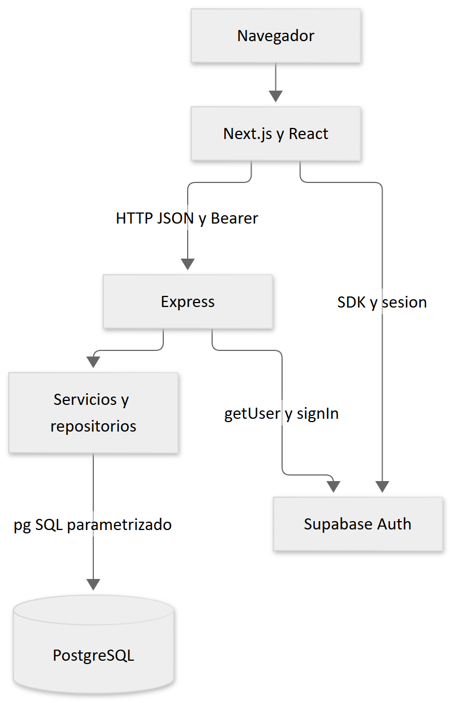

# 2 Arquitectura

El navegador consume una aplicación Next.js App Router. Sus componentes llaman a Express mediante HTTP con JSON y, en los recursos privados, un token Bearer. Express aplica controles de transporte, sesión, rol y validación, ejecuta servicios y accede a PostgreSQL mediante `pg`. Supabase ofrece Auth y puede alojar PostgreSQL; son responsabilidades distintas.

Fuente editable: [Mermaid de arquitectura](diagramas/01-arquitectura-general.mmd).

## Límites y dependencias

`frontend/src/app` compone rutas y layouts; `frontend/src/modules` agrupa pantallas y contratos por dominio; `frontend/src/shared` reúne navegación visual, utilidades y clientes comunes. No todos los módulos poseen las mismas subcarpetas. La convención de seis carpetas de `docs/architecture.md` es una intención, no una estructura uniforme implementada.

En backend, `src/routes/index.ts` monta los routers bajo `/api`. `src/app.ts` desactiva `x-powered-by`, configura proxy, cabeceras, CORS, JSON, timeout, limitador global, rutas, 404 y errores en ese orden. `/health` queda fuera del limitador de `/api`. `src/server.ts` inicia el listener; `src/app.ts` exporta `app` y `default` para reutilización y pruebas.

La capa `controllers` transforma HTTP y llama a casos de uso; `services` coordina reglas; `repositories` contiene SQL y mapeo de filas. `models/domain.ts` concentra modelos y `dtos` define contratos. No existe carpeta backend `mappers` en este commit: los mapeos están dentro de repositorios. Hay excepciones a la separación: `cashier.routes.ts` y `part-request.routes.ts` incluyen validaciones y acceso directo a repositorios.

## Errores y consistencia

`utils/app-error.ts` representa errores previstos. `middlewares/error.middleware.ts` emite `message`, `code` y detalles opcionales; transforma JSON inválido en 400 y exceso de cuerpo en 413. Los errores no previstos se registran con `console.error` y responden 500 genérico. La interfaz traduce fallos HTTP con `ApiError` de `shared/services/api.ts`.

Una transacción PostgreSQL no abarca Supabase Auth ni acciones efectuadas después del commit. Inventario, cobros y solicitudes usan bloqueos en repositorios. Asignar una orden y registrar auditoría, evento y notificación son operaciones separadas; pueden quedar parcialmente completadas. Véase [auditoría](auditoria-tecnica.md).

Referencias: [app Express](../../backend/src/app.ts), [routers](../../backend/src/routes/index.ts), [arquitectura histórica](../architecture.md).
