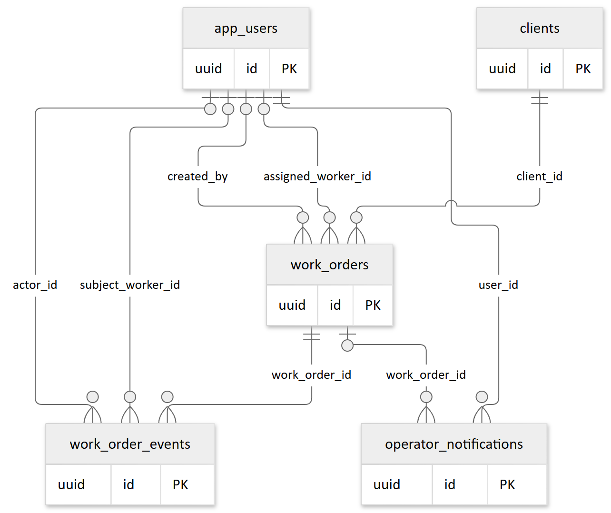
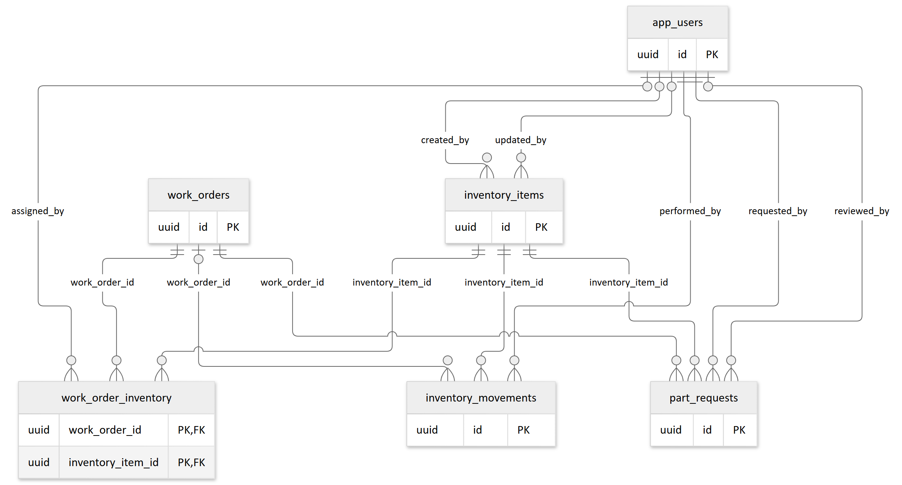
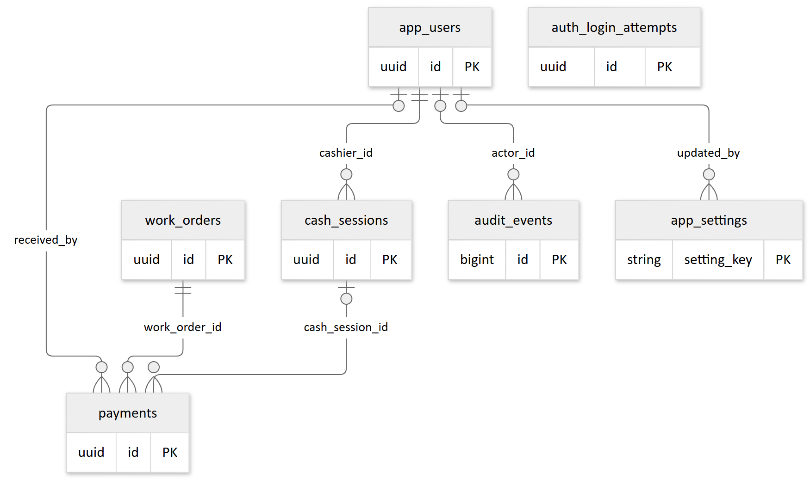

# 6 Base de datos

La persistencia usa PostgreSQL mediante `databasePool` de `backend/src/config/database.ts`; el frontend no consulta tablas directamente. El modelo siguiente refleja claves foráneas declaradas en los SQL del repositorio. No representa una inspección de producción.

El [ER completo Mermaid](diagramas/04-entidad-relacion.mmd) y su [vista vectorial ampliable](diagramas/04-entidad-relacion.svg) conservan las claves y relaciones. Para impresión se divide en tres vistas que repiten entidades compartidas; juntas cubren todas las FK. Una referencia opcional se representa con cardinalidad cero o uno; una obligatoria, con uno. El [diccionario SQL](anexo-esquema.md) completa columnas, CHECK e índices. `app_users.id` comparte identificador lógico con Auth, pero las migraciones no declaran FK a `auth.users`.

### Órdenes y personal

### Inventario y solicitudes

### Finanzas y seguridad

## Entidades

| Tabla | Clave y propósito |
| --- | --- |
| app_users | UUID provisto por Auth; correo único, rol, activo y must_change_password |
| clients | UUID; identificación única, contacto y fechas |
| work_orders | UUID; code único, client_id, técnico, estado, avance, prioridad, tracking_code único y total_amount nullable |
| audit_events | bigint identity; actor nullable, acción, entidad y details JSONB |
| inventory_items | UUID; SKU único, stock y mínimo no negativos, tipo, costo referencial y activo |
| work_order_inventory | PK compuesta work_order_id/inventory_item_id; cantidad positiva |
| payments | UUID; orden, monto positivo, método, receptor y turno opcional |
| app_settings | setting_key; valor JSONB y actor de actualización |
| work_order_events | UUID; orden, actor, técnico, tipo, mensaje y avance opcional |
| operator_notifications | UUID; usuario, orden opcional, mensaje y read_at |
| inventory_movements | UUID; artículo, tipo, cantidad positiva, stock anterior/final, responsable y orden opcional |
| auth_login_attempts | UUID; identificador/tipo únicos y ventana de bloqueo; sin FK de usuario |
| cash_sessions | UUID; cajero, apertura/cierre, efectivo esperado y contado; un turno abierto por cajero |
| part_requests | UUID; orden, artículo, solicitante, decisión, revisor, precio/cargo y coherencia de estado |

El ejecutor cloud crea adicionalmente `app_schema_migrations(name, applied_at)` para registrar nombres aplicados. No forma parte de los 14 `CREATE TABLE` de los SQL. No hay tabla de permisos ni tabla separada para trabajadores: son perfiles `OPERATOR`.

## Migraciones y orden

Existen 13 archivos, ordenados lexicalmente: `001_issue_1_admin.sql`, `002_admin_operations.sql`, `003_operational_workflow.sql`, `004_seed_admin.sql`, `005_public_order_tracking.sql`, `006_administrative_workflow.sql`, `006_cloud_app_users_compatibility.sql`, `007_order_finance.sql`, `008_inventory_end_to_end.sql`, `009_mandatory_password_change.sql`, `010_auth_security_and_rate_limits.sql`, `011_cash_sessions.sql`, `012_part_requests.sql`. Dos nombres comparten `006`; no se deben renumerar archivos ya aplicados sin un plan.

El overlay Docker monta todos los archivos para una base nueva. El ejecutor `src/scripts/cloud-database.ts` descubre SQL por nombre, omite `004_seed_admin.sql` y registra cada nombre aplicado. Desde `backend`, `npm run db:cloud` escribe en la base señalada por `DATABASE_URL`: no es un comando de inspección ni un paso automático seguro de incorporación.

**Hallazgo alto:** el ejecutor inicia una transacción por archivo, pero `011` y `012` incluyen `BEGIN` y `COMMIT`. PostgreSQL no proporciona transacciones anidadas mediante esos comandos; el COMMIT interno puede confirmar el esquema antes de registrar la migración. La aplicación y el registro dejan de ser atómicos. No se ensayó contra una base; requiere corrección y prueba aislada antes de adoptar el ejecutor para esas migraciones.

El flag `--import-local-data` copia solo diez tablas enumeradas en el script; omite movimientos, bloqueos, turnos y solicitudes, y su orden de copia no contempla todas las nuevas dependencias. No constituye un respaldo/restauración completo. No usarlo para trasladar datos productivos sin revisión.

## Integridad y transacciones

Pagos bloquea actor y orden con `FOR UPDATE`, calcula saldo y registra pago/auditoría en una transacción. Inventario bloquea artículo para descontar stock y registrar movimiento; asignación y devolución se realizan en la misma conexión. Solicitudes bloquea solicitud, orden y artículo al aprobar, descuenta stock y suma el cargo a la cotización. Caja comparte bloqueo del actor con el cobro para serializar cierre y pago.

El total aprobado no puede reducirse por debajo de lo pagado según el servicio, pero esa lectura y actualización no forman una transacción con bloqueo equivalente a pagos. Existe una ventana de concurrencia; véase [auditoría](auditoria-tecnica.md). Índices parciales relevantes: un turno abierto por cajero y una solicitud pendiente por artículo/orden. Las migraciones `011` y `012` habilitan RLS y revocan acceso a `anon`/`authenticated` en sus tablas; no extrapolar esa política al resto del esquema.

## Procedimiento de mantenimiento recomendado

Antes de aplicar una migración, identifique proyecto y entorno, obtenga respaldo, compruebe restauración en una base desechable, revise SQL y dependencias, y ensaye con `ON_ERROR_STOP`. Compare nombres registrados y esquema efectivo. Aplique únicamente archivos pendientes y compruebe restricciones y acceso con un usuario de prueba. El rollback debe diseñarse por migración: no existe un conjunto de migraciones descendentes en el repositorio. Estos pasos son recomendaciones, no verificaciones ejecutadas.
