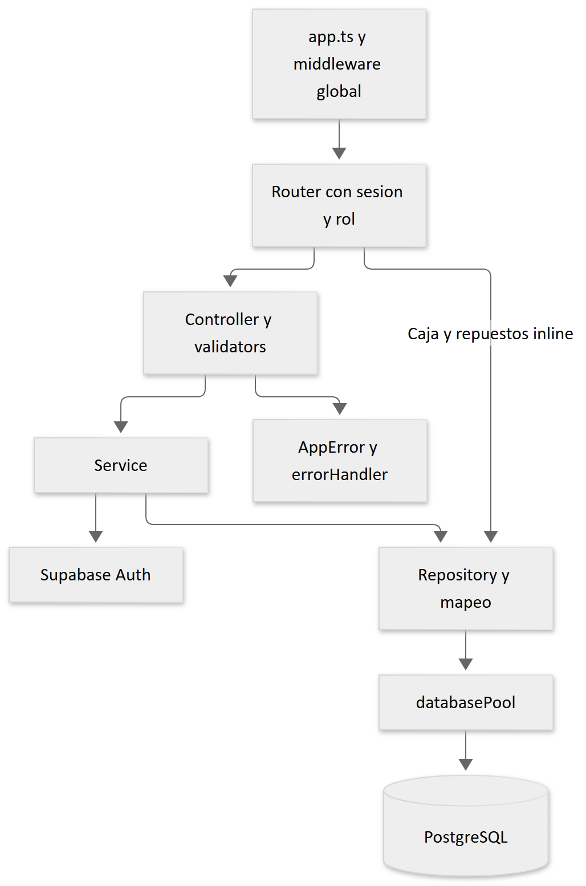

# 7 Desarrollo del backend



[Fuente Mermaid](diagramas/02-backend.mmd). La cadena predominante es router → controller → servicio → repositorio → pool. Los contratos se encuentran en `dtos`, los tipos persistidos en `models/domain.ts` y las validaciones en `validators`. Las excepciones inline de caja y repuestos deben considerarse al localizar reglas.

## Ejemplo de recorrido

`GET /api/admin/work-orders/:id` entra por `routes/admin.routes.ts`, exige autenticación y rol ADMIN y ejecuta `controllers/work-order.controller.ts`. `WorkOrderService.get` busca la orden en `WorkOrderRepository.findById`, genera `WORK_ORDER_NOT_FOUND` si no existe y devuelve el modelo al controller. Las filas SQL se convierten de snake_case a camelCase en funciones locales del repositorio; valores numeric suelen convertirse con `Number`.

Fragmento representativo de `middlewares/auth.middleware.ts`:

```typescript
request.appUser = await authService.authenticateToken(authorization.slice(7));
```

El middleware de rol se ejecuta después y comprueba también `mustChangePassword`. No confíe en roles enviados por el navegador: el perfil se consulta en PostgreSQL.

## Reglas comprobadas

- `WorkOrderService.create`: cliente existente y estado inicial PENDING.
- `assignWorker`: no asignar órdenes COMPLETED/CANCELLED, no repetir técnico y exigir OPERATOR activo.
- `OperationalRepository.change`: solo dueño; iniciar desde PENDING; avance únicamente en IN_PROGRESS y sin disminuir; completar fija 100.
- `PaymentRepository.createPaymentWithLock`: cotización definida, saldo positivo y pago menor o igual al saldo; CASHIER exige caja abierta.
- `InventoryRepository`: artículo activo, cantidad positiva validada, stock suficiente para salida y orden activa para uso en reparación.
- `SettingsService.save`: compara campos cerrados, bloquea configuración y registra cambios junto con el guardado.
- `PartRequestRepository`: solo técnico asignado solicita sobre orden activa; aprobación exige cotización, stock y límite monetario; rechazo requiere motivo en ruta.

## Añadir un caso de uso

Defina primero contrato DTO y autorización. Escriba validadores de servidor para el formato y límites; use `AppError` para fallos esperados. Mantenga SQL parametrizado y, si actualiza más de una entidad, delimite una sola conexión con BEGIN/COMMIT/ROLLBACK y liberación en finally. Registre auditoría dentro de esa transacción cuando la consistencia lo requiera. Conecte la ruta con `asyncHandler`, agregue pruebas del permiso y del error relevante y actualice el catálogo API.

No todas las operaciones actuales siguen esa atomicidad; esta pauta es una recomendación para nuevos cambios. Las operaciones que combinan Auth y PostgreSQL requieren compensación o reconciliación, porque no comparten transacción distribuida.

Comandos desde `backend`: `npm run dev`, `npm run lint`, `npm test`, `npm run build`, `npm start` después de compilar. El build genera `dist`; no aplica migraciones.

Referencias: [servicio órdenes](../../backend/src/services/work-order.service.ts), [repositorio pagos](../../backend/src/repositories/payment.repository.ts), [servicio configuración](../../backend/src/services/settings.service.ts), [validadores comunes](../../backend/src/validators/common.validators.ts).
