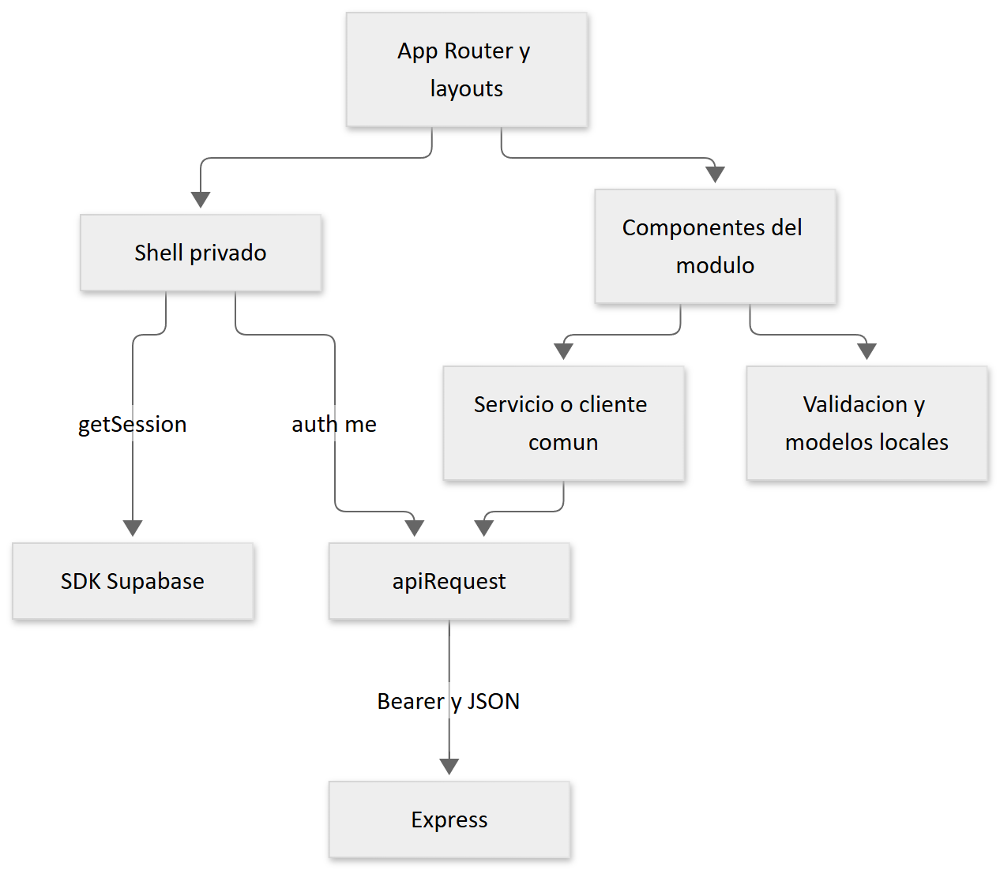

# 8 Desarrollo del frontend



[Fuente Mermaid](diagramas/03-frontend.mmd). App Router compone pantallas; los layouts privados renderizan shells del módulo auth. Los shells recuperan sesión Supabase, consultan `/api/auth/me`, comprueban contraseña temporal y rol y redirigen al inicio correspondiente mediante `shared/utils/role-home.ts`. Estos controles mejoran la navegación; el backend vuelve a autorizar cada petición.

## Flujo HTTP

`shared/services/api.ts` normaliza `NEXT_PUBLIC_API_URL`, lee `getSession()` y añade `Authorization: Bearer ...` al `fetch`. Espera JSON, convierte fallos en `ApiError` y devuelve el tipo genérico. No valida en runtime que la respuesta coincida con TypeScript. Una respuesta no JSON se interpreta como objeto vacío, salvo servicios específicos como exportación CSV.

Ejemplo real de patrón usado por el shell administrativo:

```typescript
const result = await apiRequest<{ user: AppUser }>("/api/auth/me");
```

El login usa `fetch` directamente contra `/api/auth/login`, establece la sesión con `supabase.auth.setSession` y navega a `/cambiar-contrasena` o al inicio del rol. El cierre llama a `signOut()` del SDK. La persistencia/renovación depende del cliente Supabase; no existe emisión propia de JWT por Express.

## Organización real

Settings y reports disponen de hooks, DTO, modelos y servicios propios. Inventario tiene servicios, modelos y DTO. En otros módulos, componentes llaman al cliente común sin implementar todas esas capas. El mapper comprobado `modules/settings/mappers/settings.mapper.ts` convierte impuesto textual del formulario a número y normaliza moneda; no hay un mapper genérico obligatorio para todo el frontend.

`shared/utils/validation.ts` y validaciones de formularios ayudan al usuario, pero no reemplazan las validaciones backend. `shared/utils/error-message.ts` centraliza mensajes. Componentes de badges, progreso e iconos se reutilizan desde shared. Los formularios gestionan estados de carga y error con hooks React.

## Rutas y permisos

Rutas públicas: `/login` y `/seguimiento`; la raíz tiene su propia página. Áreas privadas: `/admin/*`, `/administrativo/*`, `/operativo/*`, `/caja/*`, `/inventario/*`. `/cambiar-contrasena` permite resolver la bandera de acceso. El [inventario de páginas](anexo-rutas-frontend.md) identifica cada archivo, incluidos segmentos dinámicos y layouts cercanos.

Para extender un módulo, agregue la página como composición, mantenga el estado y formulario en componentes del dominio y reutilice el cliente HTTP. Documente contrato y error, compruebe rol tanto en API como navegación y pruebe la interacción significativa con Testing Library. Desde `frontend`, use `npm run lint`, `npm test` y `npm run build`. Las variables públicas deben estar definidas antes del build de producción.

Fuentes: [cliente HTTP](../../frontend/src/shared/services/api.ts), [login](../../frontend/src/modules/auth/components/login-form.tsx), [shell ADMIN](../../frontend/src/modules/auth/components/admin-shell.tsx), [mapper settings](../../frontend/src/modules/settings/mappers/settings.mapper.ts).
