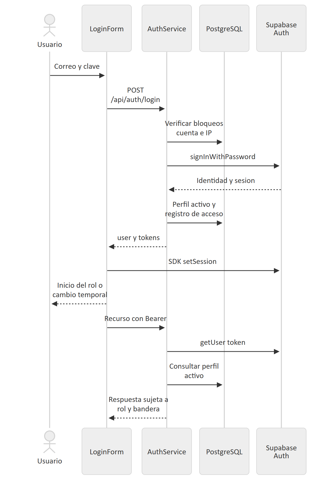

# 9 Autenticación y seguridad

La [secuencia Mermaid](diagramas/05-autenticacion.mmd) detalla participantes. El backend autentica con `signInWithPassword`; consulta un perfil activo `app_users` por UUID y devuelve usuario más accessToken, refreshToken y expiresAt. El navegador entrega ambos tokens al SDK. Para peticiones siguientes, Express llama a `getUser(token)` y consulta otra vez el perfil. No hay un login simulado ni JWT propio.

## Roles efectivos

| Área | Roles permitidos |
| --- | --- |
| /api/admin | ADMIN |
| /api/administrativo | ADMINISTRATIVE |
| /api/operativo | OPERATOR, con propiedad de orden |
| /api/inventory | ADMIN, INVENTORY |
| /api/cashier | ADMIN, CASHIER |
| /api/part-requests | OPERATOR, ADMIN, INVENTORY; crear solo OPERATOR; revisar ADMIN/INVENTORY |
| /api/auth/me y change-temporary-password | Sesión activa, sin requireRole |
| /health, /api/health, login y tracking | Públicos; límites aplicables según ruta |

ADMIN no es un superrol implícito en las áreas administrativa y operativa. `requireRole` bloquea cualquier rol con `must_change_password=true`. Las rutas de sesión y cambio deben quedar accesibles para resolver esa condición.

El reset administrativo genera contraseña temporal con `randomBytes`, impide reset propio y de inactivos, actualiza Auth y marca el perfil. La respuesta temporal es sensible y no debe registrarse en tickets o logs. La creación de usuario establece `mustChangePassword:false`; el cambio forzado comprobado corresponde al reset, no a todas las altas. La nueva contraseña exige al menos 12 caracteres, mayúscula, minúscula, número y símbolo según `auth.validators.ts`.

## Controles de entrada y transporte

Los validadores comunes normalizan texto, rechazan controles y patrones no admitidos y comprueban formatos y límites; los validadores por dominio restringen estados, montos y filtros. SQL usa parámetros, aunque ello no constituye una certificación de ausencia de vulnerabilidades. Cabeceras HTTP y límites de cuerpo se montan en `app.ts`. CORS permite orígenes configurados y previews explícitas; permite solicitudes sin Origin. CORS no es autorización de API.

Los limitadores generales y de login usan memoria por proceso (`Map`) y se limpian periódicamente. El seguimiento tiene limitador propio. Los bloqueos por cuenta/IP de autenticación también se persisten en `auth_login_attempts`; esto no convierte el límite global en distribuido. `TRUST_PROXY` debe corresponder al proxy real para no basar límites en una IP incorrecta.

El seguimiento público exige número `OT-AAAA-NNNNN` y código `MTR-` más 24 caracteres hexadecimales. El SQL genera 96 bits aleatorios. El repositorio devuelve una proyección pública y como máximo seis hitos operativos, sin notas técnicas privadas ni datos del cliente. El código de seguimiento funciona como credencial de consulta: no lo publique en ejemplos reales.

## Riesgos pendientes

La validación TLS runtime está deshabilitada salvo `DB_SSL_REJECT_UNAUTHORIZED=true`. Las migraciones no establecen RLS homogéneo para todas las tablas; permisos efectivos de Supabase son **NO VERIFICADO**. Usuarios y reseteo combinan dos sistemas sin atomicidad distribuida; deben existir reconciliación y registro operacional. Los logs de errores requieren política de retención y revisión para evitar capturar información sensible. Consulte [auditoría](auditoria-tecnica.md).

Fuentes: [AuthService](../../backend/src/services/auth.service.ts), [UserService](../../backend/src/services/user.service.ts), [middleware](../../backend/src/middlewares/auth.middleware.ts), [limitador](../../backend/src/middlewares/rate-limit.middleware.ts), [tracking](../../backend/src/repositories/public-tracking.repository.ts).
