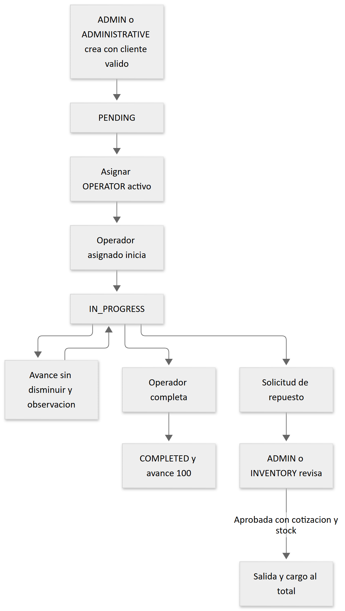

# 11 Módulos funcionales

Estado de esta sección: implementación conectada en el commit auditado. Las pruebas citadas usan dobles en varios límites; su existencia no certifica la operación cloud. Los endpoints completos y archivos de página están en los [anexos API](anexo-endpoints.md) y [frontend](anexo-rutas-frontend.md). Todos los nombres de archivo de las tablas son relativos a `backend/src`, salvo donde se indique lo contrario.

## Autenticación y administración de usuarios

Objetivo: gestionar acceso y perfiles. Frontend: `modules/auth/components/login-form.tsx`, shells y cambio temporal; `modules/users/components/users-view.tsx`. Backend: `controllers/auth.controller.ts`, `controllers/user.controller.ts`, `services/auth.service.ts`, `services/user.service.ts`, repositorios `user` y `auth-security`. Tablas: `app_users`, `auth_login_attempts`, `audit_events`; identidad remota Supabase Auth.

Login es público; `/auth/me` y cambio requieren sesión; CRUD de usuarios y reset requieren ADMIN. El flujo formulario → AuthService → Supabase → perfil → sesión se describe en [seguridad](09-autenticacion-seguridad.md). Formatos de correo, texto, rol y contraseña se validan en controllers/validators. Las altas generan perfil activo sin cambio obligatorio; el reset activa la bandera. No se permite inactivar la propia cuenta ni resetear la propia contraseña. No se identificó un control equivalente que impida perder el último ADMIN mediante cambio de rol; requiere análisis adicional.

Pruebas: `backend/tests/user-service.test.ts`, `auth-authorization.test.ts`, `password-reset.test.ts`, `password-reset-http.test.ts`, `login-protection.test.ts`; frontend `login-form.test.tsx`, `change-temporary-password-form.test.tsx`. Límite: Supabase y SQL no comparten transacción; no hay certificación de revocación de todas las sesiones remotas.

## Dashboards y búsqueda

Objetivo: resumir información del área y localizar entidades. Frontend: `modules/dashboard/components/dashboard-view.tsx`, `administrative-dashboard-view.tsx`, dashboard operativo e inventario/caja; búsqueda en `modules/search/components/global-search.tsx`. Backend: controllers y servicios `dashboard`, `administrative-dashboard`, `operators`, `operational`, `cashier`, `inventory`; `repositories/search.repository.ts`. Endpoints representativos: `/api/admin/dashboard`, `/api/admin/search`, `/api/administrativo/dashboard`, `/api/operativo/dashboard`, `/api/inventory/dashboard`, `/api/cashier/dashboard`.

Roles: el propio router de cada área. Las métricas consultan usuarios, clientes, órdenes, inventario o pagos según el repositorio. Búsqueda global se restringe a ADMIN y sanea texto. Pruebas: `backend/tests/search.test.ts`, `administrative-services.test.ts`, frontend `dashboard-view.test.tsx`, `administrative-dashboard-view.test.tsx`, `global-search.test.tsx`. Limitación: no asumir que todos los dashboards calculan fechas con igual zona horaria; SQL operativo usa CURRENT_DATE y otros módulos convierten explícitamente America/Guatemala.

## Clientes

Objetivo: mantener identificación y contacto y consultar sus órdenes. Frontend `modules/clients/components/clients-view.tsx`, `client-detail-view.tsx`; áreas ADMIN y ADMINISTRATIVE. Backend: `controllers/client.controller.ts`, `services/client.service.ts`, `repositories/client.repository.ts`; tabla `clients`, relación con `work_orders`. Endpoints GET/POST `/clients`, GET/PUT `/clients/:id`, GET `/clients/:id/work-orders` bajo los dos prefijos autorizados.

El formulario envía DTO, controller valida y el repositorio usa SQL parametrizado. Identificación admite DPI/NIT/PASSPORT según contrato; correo/teléfono son opcionales y la identificación tiene UNIQUE. No se documenta una eliminación inexistente. Pruebas: `administrative-services.test.ts`, `administrative-http-authorization.test.ts`, `security-validation.test.ts`; frontend `clients-view.test.tsx`. Límites: no se verificó catálogo externo de identificación ni datos reales.

## Órdenes de trabajo

Objetivo: registrar motor y servicio, asignar responsable y seguir ejecución. Frontend `modules/work-orders/components/work-orders-view.tsx`, `administrative-work-orders.tsx`, `order-timeline.tsx`. Backend controllers/servicios/repositorios `work-order`, `order-timeline` y `operational`; tablas `work_orders`, `clients`, `app_users`, `work_order_events`, `operator_notifications`, `audit_events`, además de movimientos/pagos para timeline consolidada.

ADMIN y ADMINISTRATIVE pueden crear, editar y asignar por sus routers. La creación verifica cliente y fija PENDING. La asignación exige OPERATOR activo y orden no terminada/cancelada. Solo OPERATOR asignado inicia, registra avance y completa. Se validan textos, prioridad, fechas y progreso; la actualización general no acepta cambio de estado arbitrario. CANCELLED existe en modelo/constraint, pero no se encontró endpoint específico para cancelar en los routers auditados: no se presenta como flujo operativo disponible.

[Fuente editable](diagramas/06-orden-trabajo.mmd). Los cambios operativos bloquean la fila y registran su evento en la transacción; auditoría de servicio ocurre después. Pruebas: `order-timeline.test.ts`, `order-timeline-http.test.ts`, `work-order-controller-protection.test.ts`, `operational-authorization.test.ts`; frontend `work-orders-view.test.tsx`, `administrative-work-orders.test.tsx`, `order-timeline.test.tsx`. Limitación: asignación/notificación/auditoría no forman una sola transacción.

## Personal operativo

Objetivo: listar técnicos activos y ofrecer trabajo asignado, actividad y notificaciones. Frontend `modules/operators/components/operators-view.tsx`, `modules/operational/components/*`; backend `operators.service.ts`, `operational.service.ts`, `operational.repository.ts`. Un técnico es un `app_users` OPERATOR; no existe una entidad independiente de empleados.

GET `/api/admin/operators` o `/api/administrativo/operators` lista personal. Área `/api/operativo`: orders, start, progress, complete, activity y notifications. Rol OPERATOR y propiedad comprobada para detalle/historial/cambios. Avance no disminuye, finalización solo desde IN_PROGRESS, notificación solo se marca para su destinatario. Pruebas `operational-authorization.test.ts`, `administrative-authorization.test.ts`. Pendiente: prueba integral con cuentas y notificaciones reales **NO VERIFICADO**.

## Inventario y solicitudes de repuestos

Objetivo: mantener catálogo y existencias trazables. Frontend `modules/inventory/components/inventory-workspace.tsx`, `inventory-view.tsx`, `inventory-item-form.tsx`, `inventory-movement-dialog.tsx`, `part-requests.tsx`, servicios/modelos/DTO del módulo. Backend controllers `inventory` e `inventory-v2`, `services/inventory.service.ts`, `repositories/inventory.repository.ts`, `validators/inventory.validators.ts`.

ADMIN e INVENTORY usan `/api/inventory/items`, entries, exits, status y movements. El inventario legado `/api/admin/inventory` y asignación a órdenes siguen montados: coexistentes, no obsoletos eliminados. Tablas `inventory_items`, `inventory_movements`, `work_order_inventory`, `work_orders`, `app_users`, `audit_events`. Stock no negativo; entradas/salidas requieren cantidades válidas y artículo activo; salida de reparación requiere orden activa. Asignar descuenta y devolver repone con movimiento en transacción.

Solicitudes usa `routes/part-request.routes.ts` y `repositories/part-request.repository.ts`, sin servicio/controller separado. OPERATOR solicita para su orden activa; ADMIN/INVENTORY revisa. La aprobación requiere cotización y stock, fija precio de venta, genera salida y suma cargo al total. Rechazo requiere nota. No se permite otra solicitud pendiente del mismo artículo/orden. La aprobación no agrega una fila a `work_order_inventory`; se consulta por `part_requests` y movimientos. El catálogo excluye TOOL. El costo original se retira del listado para OPERATOR.

Pruebas `inventory.service.test.ts`, `inventory.validators.test.ts`, `inventory-allocation-transaction.test.ts`, `part-requests.test.ts`, `part-requests-http.test.ts`; frontend `modules/inventory/models/inventory.test.ts`. Limitación: no se afirma inmutabilidad por trigger de movimientos ni reversión automática de solicitudes aprobadas; no existen esas garantías en los SQL examinados.

## Caja y finanzas

Objetivo: cotizar, registrar cobros y controlar turnos. Frontend `modules/finance/components/finance-view.tsx`, `cashier-workspace.tsx`, `cash-session-panel.tsx`, `cashier-orders.tsx`, modales e historial; servicios `finance.service.ts`, `cashier.service.ts`. Backend payment/cashier controllers y services, repositorios `payment`, `cashier`, `cash-session`; validadores finance/cashier. Tablas `work_orders`, `payments`, `cash_sessions`, `app_users`, `audit_events`.

ADMIN cambia total por `/api/admin/work-orders/:id/finance`; ADMIN/CASHIER cobran por `/api/cashier/payments`; sesiones bajo `/api/cashier/sessions`. Pagos requieren total definido, importe positivo y saldo suficiente. CASHIER necesita turno abierto; ADMIN puede cobrar sin turno. La caja calcula efectivo esperado con saldo inicial y métodos cash/efectivo; diferencia exige observación. Índice parcial impide dos turnos abiertos por cajero. El servicio impide total menor al pagado, pero persiste riesgo concurrente documentado.

Pruebas `finance.test.ts`, `finance-http.test.ts`, `cash-sessions.test.ts`; frontend `finance-view.test.tsx`, `cashier-orders.test.tsx`. Limitaciones: no hay comprobación de una pasarela bancaria, reversos o facturación tributaria implementados; la captura de método/referencia no acredita un pago externo.

## Reportes

Objetivo: consultar indicadores y listados por dominio y exportarlos a CSV. Frontend `modules/reports/components/reports-view.tsx`, tablas, export-csv-button; `hooks/use-reports.ts`, servicios, modelos y DTO. Backend `controllers/reports.controller.ts`, `services/reports.service.ts`, `repositories/reports.repository.ts`, validadores y `utils/reports-csv.ts`. Solo ADMIN. Tablas consultadas según reporte: órdenes, clientes, inventario, movimientos, pagos y usuarios relacionados.

GET `/api/admin/reports/*` aplica filtros por fechas/estado/búsqueda según tipo; rango inicial no puede superar final y paginación debe ser positiva. Export limita a 5000 filas e informa truncamiento. Se sanitizan valores CSV en utilidad y hay pruebas específicas. Pruebas `reports-http.test.ts`, `reports.validators.test.ts`, `reports.repository.test.ts`, `reports-export.service.test.ts`, `reports-csv.test.ts`; frontend servicios/vista/exportación. CSV está implementado; PDF no encontrado. La mención histórica de CSV pendiente es obsoleta respecto de este commit.

## Auditoría

Objetivo: conservar acciones relevantes con actor y detalles y permitir revisión ADMIN. Frontend `modules/audit/components/audit-view.tsx` y helpers; backend `controllers/audit.controller.ts`, `services/audit.service.ts`, `repositories/audit.repository.ts`. Tabla `audit_events`; GET `/api/admin/audit`. Las operaciones llaman a AuditService, algunas con conexión transaccional y otras después de persistir. No es un interceptor que garantice registrar cualquier petición.

Pruebas indirectas en settings, pagos, caja, reset y solicitudes; frontend `audit-helpers.test.ts`. Limitaciones: no se identificó retención automática, almacenamiento externo inmutable ni garantía transaccional universal. No imprimir detalles reales de auditoría en el manual.

## Seguimiento público

Objetivo: consultar avance sin cuenta privada. Frontend `modules/public-tracking/components/*`, servicio, modelo, utilidades de enlace/WhatsApp y QR. Backend controller/service/repository public-tracking, validador y limitador propios. POST `/api/public/orders/tracking` consulta `work_orders` y `work_order_events` con par número/código; solo publica campos seleccionados e hitos genéricos.

Pruebas `backend/tests/public-tracking.test.ts`; frontend vista, enlaces, WhatsApp, QR y compartir. Limitación: quien dispone del par de códigos puede consultar; compartir enlaces requiere cuidado y no constituye autenticación del cliente.

## Configuración general

Objetivo: mantener taller, moneda e impuesto. Frontend `modules/settings` contiene componente, hook, DTO, modelo, mapper y servicio. Backend settings controller/service/repository/validators; tablas `app_settings`, `audit_events`. GET/PUT `/api/admin/settings`, solo ADMIN. Contrato cerrado `company{name,phone,address}` y `finance{currency,taxRate}`; rechaza campos extra y registra únicamente cambios, en la misma transacción.

Pruebas `settings.validators.test.ts`, `settings.service.test.ts`, `settings-http.test.ts`; frontend modelo, servicio y vista. Límite: guardar un impuesto no prueba que todos los cálculos de negocio lo apliquen; no se atribuye al módulo un motor de facturación.
