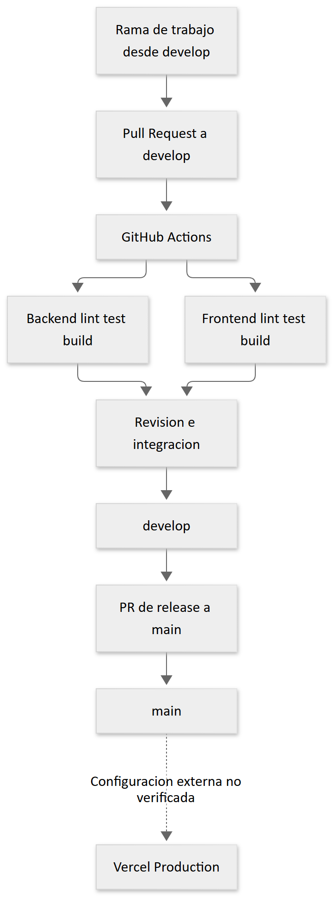

# 13 Git y colaboración



[Fuente Mermaid](diagramas/07-git-ci.mmd). La política documentada en `docs/development.md` es trabajar desde develop, abrir PR hacia develop y preparar release hacia main. La CI se dispara por push y PR en develop/main. Las protecciones de rama, revisiones obligatorias y vinculación efectiva con Vercel son **NO VERIFICADO**: el YAML no demuestra esos ajustes externos.

## Procedimiento reproducible

```powershell
git status --short
git fetch origin develop
git switch develop
git merge --ff-only origin/develop
git switch -c feature/descripcion-del-cambio
```

Ejecute el procedimiento solo con árbol limpio o cambios previamente resguardados. Si fast-forward no es posible, revise la divergencia antes de resolverla. Para este trabajo se creó explícitamente `docs/manual-tecnico-desarrolladores` desde `origin/develop` después de comprobar igualdad entre rama local y remota; no se modificó main.

Antes de solicitar revisión, inspeccione diff, corra validaciones relevantes y `git diff --check`. Un PR debe explicar el problema, comportamiento, contratos alterados y resultados reales. Coordine modificaciones a rutas raíz, contratos y migraciones. No cambie nombres de migraciones ya registrados sin acordar el tratamiento de las instancias existentes.

La entrega inicial de auditoría no ejecutó commit, push ni apertura de PR. La publicación posterior de esta documentación hacia `develop` fue autorizada expresamente y mantiene pendiente la revisión. No se autoriza merge ni modificación de `main`. Historial y guía: [desarrollo](../development.md), [workflow CI](../../.github/workflows/ci.yml).
