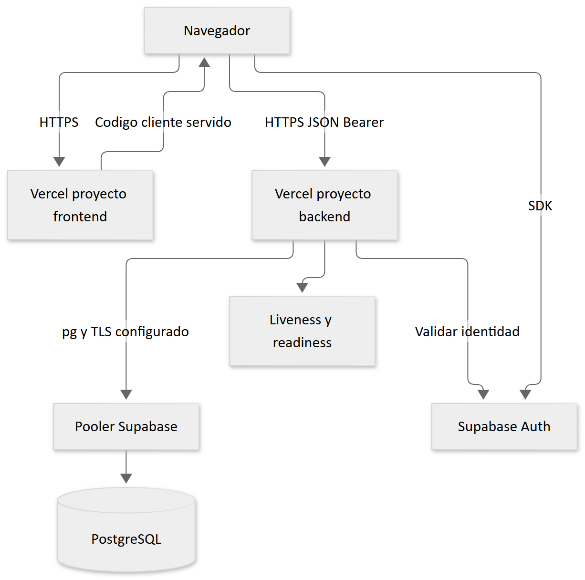

# 14 Despliegue y mantenimiento

[Fuente Mermaid](diagramas/08-despliegue.mmd). La guía existente propone dos proyectos Vercel con raíces `frontend` y `backend`, PostgreSQL y Auth en Supabase. El código exporta una app Express reutilizable y declara Node 24.x. No se encontró `vercel.json` en ninguno de los dos subproyectos. La configuración efectiva de framework, integración Git y dominios es **NO VERIFICADO**; no se realizó un despliegue durante la auditoría.

## Preparación de una entrega

1. Seleccione un commit revisado y ejecute lint, pruebas y build de ambos proyectos.
2. Compruebe contratos API y compatibilidad de esquema en un entorno aislado.
3. Configure backend con DATABASE_URL, TLS verificado, claves Supabase privadas, orígenes y pool adecuados al número de instancias. No copie secretos a la descripción del despliegue.
4. Configure frontend con las tres variables públicas antes de construir. Cambiarlas requiere regenerar el build.
5. Configure en la plataforma la raíz, versión Node, rama de producción y variables por ambiente. Confirme esos ajustes en vez de inferirlos de la documentación.
6. Aplique únicamente migraciones revisadas y ensayadas, con respaldo y plan de recuperación. Los riesgos del ejecutor actual se describen en [base de datos](06-base-datos.md).
7. Compruebe `/health`, `/api/health`, login, rol, creación/consulta de una orden de prueba y navegación pública con datos ficticios del entorno de ensayo.

Este es un procedimiento recomendado; no constituye evidencia de despliegue exitoso. `/api/health` solo valida conectividad mediante SELECT 1. No verifica que todas las migraciones estén aplicadas ni que Auth esté disponible.

## Mantenimiento

Controle errores 5xx, latencia, conexiones del pool, bloqueos, saldo/stock y eventos de acceso fallido. Una instancia serverless puede reiniciar límites en memoria; dimensione la protección perimetral/distribuida según riesgo. Revise dependencias con un proceso separado de actualización y pruebas; no se ejecutó una auditoría de vulnerabilidades de proveedores en este trabajo.

Defina retención y acceso a logs/auditoría, copias cifradas y simulacros de restauración. No hay evidencia versionada que acredite una política operativa de backups. La recuperación de frontend/backend debe fijar un commit compatible con el esquema existente; revertir código no revierte SQL ni operaciones Auth. Verifique perfiles huérfanos y acciones parcialmente completadas antes de reintentar operaciones sensibles.

Referencias: [despliegue histórico](../deployment-vercel.md), [migración Supabase](../migracion-supabase.md), [pool](../../backend/src/config/database.ts), [servidor](../../backend/src/server.ts).
